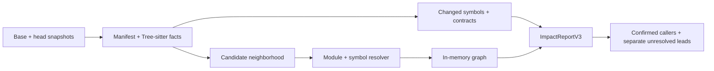

# GitHub PR Review Bot — Implemented Plan Summary

Snapshot: **23 November 2026 (Asia/Kolkata)**

Ye file ab tak implement hue plan ka consolidated overview hai. Detailed history, problems aur handoff ke liye [PROJECT_NOTES.md](PROJECT_NOTES.md) padho. Features ka local implementation, automated verification aur live production status alag hain.

## 1. Overall status

| Hissa | Ab tak ka status |
| --- | --- |
| Core advisory PR review pipeline | Application code implemented; live end-to-end validation pending |
| Trigger reliability / review-run claims | Delivery dedup, snapshot/config identity aur durable run-state handling implemented |
| Phase 1: commit manifest + facts | Parser, fingerprints, facts cache aur identifier index implemented; current parser version `v8` |
| Phase 2: neighborhood + impact | In-memory resolver, graph, contracts aur impact report implemented with synthetic regression coverage; original complete fixture/property gate formally reconciled nahi hai |
| Production workflow mein Phase 2 integration | Is phase ke scope mein nahi; analysis helpers live Inngest/publication workflow se wired nahi hain |
| Phase 3 oracle benchmark | Start nahi hua |
| Database URL / live DB verification | User ke instruction par filhaal excluded |

## 2. Core PR review pipeline

| Feature | Implemented behavior | Main files |
| --- | --- | --- |
| HTTP server | Health route, webhook route, Inngest endpoint aur graceful shutdown | `app.js`, `index.js` |
| Configuration | Validated settings, repository allowlist, bot policy, concurrency, limits aur kill switch | `config.js` |
| Webhook security | Raw request body par HMAC verification; invalid signature reject; queue failure par retryable response | `github/webhook.js` |
| Review orchestration | Debounce, keyed concurrency, retries, fresh PR eligibility aur stale-snapshot checks | `inngest/function/review-pr.js` |
| Context | Commit-specific diff/context, whole-hunk limits, missing-patch recovery aur skipped-file coverage | `review/context.js` |
| AI review | Strict structured output, evidence validation, confidence filtering aur maximum five findings | `review/ai.js` |
| Safety / token limits | Pattern redaction, publication sanitization aur model-aware token estimation | `review/safety.js`, `review/tokenizer.js` |
| Budget accounting | Atomic repository/global/PR budgets aur actual usage reconciliation | `review/store.js` |
| Publication | Explicit reviewed commit, marker lookup, invalid-inline summary fallback aur ambiguous-write reconciliation | `review/publish.js` |
| Recovery | Durable publication states, installation write pacing aur scheduled recovery | `review/store.js`, `inngest/function/recover-publications.js` |

Bot advisory reviews deta hai. PR code execute karna, code edit karna, approve/block/merge karna product scope mein nahi hai.

## 3. Trigger aur reliability updates

- Webhook GitHub PR lookup ka wait kiye bina event enqueue karta hai; workflow live state verify karta hai.
- GitHub **delivery ID** transport event ko deduplicate karti hai.
- Actual review claim ki identity mein installation/repository/PR, **base SHA, head SHA aur effective review configuration** shamil hain.
- PostgreSQL `review_run` claim duplicate work ke against durable safety net hai; done/failed/stale state aur abandoned-run handling implemented hain.
- Temporary budget-store failure successful `done` completion nahi banti; retryable failure rehti hai.
- Freshness checks purane snapshot ka result publish hone se rokte hain; ambiguous GitHub writes retry se pehle reconcile hote hain.

Main files: `review/identity.js`, `github/webhook.js`, `inngest/function/review-pr.js`, `review/store.js`.

## 4. Phase 1 — Commit manifest aur facts

| Component | Implemented work |
| --- | --- |
| Manifest | Commit tree se path-to-blob mapping; truncated tree ko non-recursively re-read/walk karna; request cap aur partial status |
| Archive extraction | Tar/gzip, GNU long paths, PAX headers, link exclusions, traversal rejection aur oversized-entry discard |
| Parsing | Tree-sitter WASM se JS/TS/JSX/TSX aur related extensions; file-size/minification checks; worker timeout |
| Facts | Symbols, imports/exports/reexports, calls, JSX, value references, inheritance, lexical scope, receiver/type evidence aur diagnostics |
| Fingerprints | Signature, body-token aur structure fingerprints; comment/line-shift invariance aur string-literal whitespace preservation |
| Storage | `file_facts` aur `file_identifier_index`; blob/parser-version lookup aur injected-store helpers |
| Cache correctness | Path/language mismatch par reparse; parser facts format badalne par cache-version invalidation |

Main files: `analysis/manifest.js`, `parser.js`, `parser-worker.js`, `queries.js`, `fingerprint.js`, `types.js` aur `review/store.js`.

Current **`PARSER_VERSION = 'v8'`** hai. Purane stored facts ko current extraction ke liye reindex karna hoga; historical database rows delete nahi ki gayi hain.

Config JSON files manifest mein identify hoti hain. Unki general code-facts extraction ke bajay sync explicit partial coverage deta hai; module resolver supplied pinned config contents ko read karta hai.

## 5. Phase 2 — Resolver, graph aur impact report

### Module aur symbol resolution

`analysis/resolver.js` TypeScript `resolveModuleName` ko supplied snapshot ke in-memory host ke saath use karta hai. Type-check ya repository code execution nahi hota.

Implemented paths:

- Relative/extension/index resolution aur supplied tsconfig ke paths/baseUrl/extends.
- Snapshot workspace packages ke exports; external packages repo-code target nahi bante.
- Lexical local/nested/closure calls aur named, aliased, default, namespace imports.
- Re-export chains, star exports, ambiguity handling aur cycle/depth guards.
- Static CommonJS destructuring, namespace, require-property aur uniquely bound function exports.
- Unique same-file/cross-file inherited methods aur exact local `new` receiver evidence.
- Typed fields aur constructor parameter properties se conservative probable leads.

Resolution labels **confirmed / probable / unresolved** hain. Name match akela confirmed evidence nahi hai. Shadowing, reassignment, conditional/conflicting exports, parse errors aur ambiguous targets ko conservative rakha gaya hai.

### In-memory dependency graph

`analysis/graph.js`:

- `import`, `reexport`, `direct_call`, `jsx_use`, `value_ref`, `extends` edges.
- Deterministic edge keys aur separate call-site evidence.
- Caller traversal mein import/reexport edges exclude; importer query alag.
- Default one-hop analysis; contract changes par two hops; maximum 20 caller results per traversal.
- Cycle handling, truncation flag aur multi-hop evidence paths.
- Har graph-build confirmed edge par unique target/explanation guard; invalid evidence unresolved hota hai.

### Contract aur impact analysis

`analysis/contracts.js` contract changes ko **hypothesis inputs** ke roop mein deta hai: export removal/rename/binding, async/generator, parameters, defaults, optionality, modifiers, return shape, throw expressions aur heritage.

`analysis/impact.js`:

- Base/head facts se added, modified, removed, renamed, signature_changed aur export_changed symbols.
- Rename/move inference par confidence below 1 aur explicit reason.
- Deleted/moved symbols ke liye base-snapshot caller evidence.
- Identifier-index candidates, static importer/barrel expansion aur missing-index fallback.
- Private helper se exported function aur external caller tak supported propagation.
- Config/schema/route/env/import changes ko separate signals.
- Zod-validated `ImpactReportV3`: changed symbols, confirmed callers, contracts, hypotheses, unresolved leads, index/neighborhood coverage aur limits.



Ye analysis flow abhi production publication flow se independent hai.

## 6. Actual verification recorded

Latest selected non-DB command:

```sh
node --test tests/backend.test.js tests/analysis-facts.test.js tests/analysis-resolver.test.js tests/analysis-impact.test.js
```

Result: **128 total, 128 pass, 0 fail, 0 skipped**.

- Is command ne DB integration test file run nahi ki. Ye full `npm test` ya live DB result nahi hai.
- Scoped JavaScript syntax checks aur tracked-file `git diff --check` pass hue.
- Earlier full suite snapshot: 124 total, 123 pass, 1 DB test skipped; ye latest code ka rerun nahi hai.
- Earlier synthetic performance sample: 81 candidate files, 160 edges, 3.67 ms graph resolution; parsing/network time excluded. Iske baad code badla hai, isliye current performance guarantee nahi hai.
- Quality precision/recall, Phase 3 oracle aur live GitHub/OpenAI/Inngest end-to-end outcome measure nahi hua.

Is summary-document creation mein application tests dobara nahi chalaye; upar recorded checks summarize kiye hain.

## 7. Remaining boundaries aur next steps

1. Original Phase 2 ke complete 22 fixture groups aur property gate ko requirement-by-requirement reconcile karna. Existing test count akela complete-gate proof nahi hai.
2. Dynamic/computed calls, non-exact typed receivers, conflicting mutations aur complex runtime behavior intentionally probable/unresolved rahenge.
3. Workspace aliases ko Node `path.matchesGlob` API chahiye; unavailable API par resolution degrade hoti hai.
4. Current parser-version facts ka reindex aur historical-data cleanup ka decision baaki hai.
5. Phase 3 oracle benchmark ke liye separate approval required hai.
6. Production credentials/setup, live integrations, selected-repository quality pilot aur owner notifications verify karna baaki hai. Database URL wala work user ne filhaal exclude kiya hai.

Phase 2 mein new database tables ya production wiring add nahi ki gayi. Protected files mein pehle ke workspace changes maujood hain; Phase 2 ke dauran unhe naya modify nahi kiya gaya.
