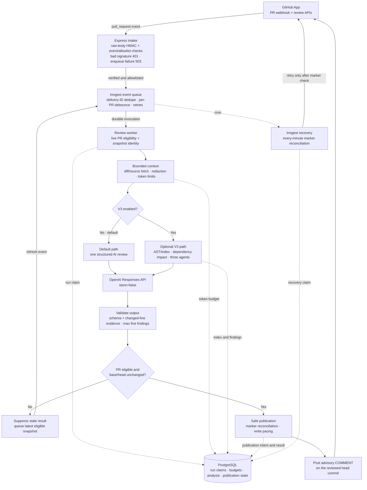

# GitHub PR Review Bot — Project Notes

Last updated: 24 November 2026 (Asia/Kolkata)

## Current delivery status

Corrected Plan v4 ka application-code scope implement ho chuka hai: secure/current-state webhook intake, bounded and redacted review context, evidence-validated AI output, atomic token budgets, snapshot-safe GitHub publishing, ambiguous-write reconciliation, installation-wide pacing aur scheduled publication recovery. Latest verification `npm test` mein 35/35 tests pass aur changed JavaScript files ke syntax checks pass hain. Inngest registration aur dependency-tree checks bhi pass hue.

Railway par PostgreSQL aur API service provision ho chuke hain aur public GitHub source connected hai. API credentials missing hone se runtime start nahi hota; real PostgreSQL query, GitHub App, OpenAI/Inngest integration, live end-to-end run aur selected-repository pilot verify nahi hue. Isliye production rollout aur quality/notification verification abhi pending hain; local checks ko live integration ka substitute na samjho.

## Is document ka purpose

Ye project ka main design aur handoff document hai. Nayi session mein ise padho, phir implementation status ko actual source files se verify karo. Corrected Plan (v4) product requirements ka latest reference hai; neeche us design ko current code ke status se alag rakha gaya hai.

- User project ko incremental, aam taur par ek file/step per request, implement karna chahta hai.
- Explanation Roman Hindi/Hinglish mein; code JavaScript ES modules mein.
- Requested code ke bahar refactor ya scaffolding mat karo.
- Har project change, design decision, actual check/result, encountered problem, uska cause/fix, blocker aur next step isi `PROJECT_NOTES.md` mein record karo. Naya project-related handoff/update kisi doosri Markdown file mein mat banao jab tak user specifically na kahe.
- Koi problem aaye to pehle is document ke design contracts, safety rules aur invariants follow karke diagnose/fix karo. Fix existing contract se takraye ya missing decision par depend kare to code ko guess se badalne ke bajay pehle concern/decision yahin record karo aur zaroori clarification lo.
- `.env`, tokens, private keys, real webhook payloads ya private source code ko read, print, copy ya document mat karo.
- Source code actual implementation ka authority hai. Plan ko implemented feature tabhi bolo jab code mein ho aur verification result actual command se mila ho.

## Product goal aur scope

Selected GitHub App repositories ke non-draft pull requests par advisory AI review dena. Review mein author ke changes ka summary, maximum paanch evidence-supported findings, reviewed commit aur coverage report ho. Configured owner ko same review body mein mention kiya ja sakta hai.

Bot sirf review karega. Ye code execute/edit, PR approve, block ya merge nahi karega. Fork ka code kabhi execute nahi hoga. V1 mein dashboard, billing aur manual review commands nahi hain. Initial quality evaluation JavaScript/TypeScript repositories par hogi; App permissions selected repositories tak limited rahengi.

## Stack aur system boundaries

- Node.js JavaScript ES modules, Express HTTP server.
- GitHub App installation authentication aur API calls: Octokit + `@octokit/auth-app`.
- Durable webhook processing, debounce, concurrency aur retry: Inngest.
- Review: OpenAI Responses API, strict structured output, `store: false`.
- Validation: Zod. Diff/anchor utilities: `diff` dependency; current anchor parser custom/simple hai.
- Durable budgets/publication state: current code PostgreSQL (`pg`) use karta hai. Deployment target ke hisaab se storage choice confirm hogi, lekin atomic budget accounting aur durable publication state mandatory hain.
- Automated verification: `node:test` + Supertest.

`package.json` mein `test` script `node --test` hai. Dependency declarations actual manifest se check karo; purane notes ka dependency status stale ho sakta hai.

## System design diagram

Yeh portrait chart current source workflow ko dikhata hai. Default review path single structured AI review hai. Three-agent static-analysis path sirf REVIEW_V3_ENABLED=true par chalta hai. Chart live Railway, PostgreSQL, GitHub App, OpenAI ya Inngest integration ka current health verified hona nahi dikhata.

### Portrait workflow diagram

Delivery se final PR comment tak ka main path, default AI mode, optional V3 lane, durable state aur recovery ek vertical chart mein:



### Component responsibility map

| Boundary | Source | Responsibility |
| --- | --- | --- |
| Process and configuration | index.js, config.js, app.js | Validate environment; construct Store, Inngest functions and webhook handler; expose liveness, webhook and Inngest routes. |
| Webhook intake | github/webhook.js | Verify the raw-body HMAC; filter supported actions and allowlisted repositories; enqueue a delivery-ID keyed event or cancellation. |
| Durable orchestration | inngest/function/review-pr.js, inngest/function/recover-publications.js | Debounce and serialize work per PR, enforce global concurrency, retry transient failures and recover unresolved GitHub writes. |
| GitHub boundary | github/client.js | Create installation-scoped Octokit clients; read live PR state and source; publish review output. |
| Default analysis | review/context.js, review/ai.js | Collect a bounded, redacted diff/context; estimate model tokens; request strict structured output; validate findings against exact changed-line evidence. |
| Optional static analysis | review/pipeline.js, analysis/ and review/evidence.js | Index JS/TS/JSX/TSX snapshots, resolve symbols and dependency edges, compute impact and assemble bounded evidence for three agents. |
| Durable state | review/store.js, review/analysis-store.js | Atomically account budgets, claim snapshot runs, retain publication/recovery state and persist versioned analysis facts. |
| Publication safety | review/publish.js | Recheck eligibility and base/head, rate-space installation writes, use a bot marker, reconcile ambiguous results, and retry summary-only when inline locations are rejected. |

### Durable data groups

| Data group | Main tables | Purpose |
| --- | --- | --- |
| Review control | review_run, review_publication, review_write_schedule, review_write_slot | Snapshot idempotency, publication state/recovery, and installation-wide write pacing. |
| Cost control | review_budget, review_reservation, review_v3_budget, review_v3_reservation | Reserve before model calls, settle known usage, and preserve an unknown reservation when a provider call may have succeeded but its response was lost. |
| Snapshot index | repo_index_state, repo_file_symbols, repo_dependency_edges, file_facts, file_identifier_index | Cache parser/resolver-versioned metadata for commit snapshots; the code does not execute repository files. |
| Derived review state | review_analysis_artifact, review_v3_metrics, review_finding_state | Store bounded analysis references/results, sanitized numeric metrics and finding history used to avoid repeated reports. |

Current V3 index ceilings are 500 supported source files, 5 MiB total input, 500 KiB per file and 10,000 dependency edges. Diff and model input have separate configurable file, character and token limits. The V3 pipeline persists derived facts and compact artifacts; agent prompts/source excerpts are not written as workflow step outputs.

### Correctness, privacy and failure contracts

- Treat webhook payloads, PR title/body, diff and source as untrusted data. HMAC verification uses the original request bytes; allowlisting and live GitHub state checks happen before model work.
- Tie each result to installation, repository, PR, base SHA, head SHA and review configuration. Re-read the live PR before expensive stages and before a write; if base/head changed, suppress that result and enqueue the latest eligible snapshot.
- Delivery IDs and Inngest idempotency/debounce reduce duplicate work; PostgreSQL run claims and GitHub review markers are the durable safety nets. A failed marker lookup is not evidence that no review exists.
- Bound and redact model context, use strict structured output, require evidence from the transmitted changed lines, and publish no more than five evidence-supported findings. Requests set store=false.
- The publisher creates an advisory COMMENT review on the reviewed head commit. The bot does not approve, block, merge or execute PR code.
- A queue failure returns 503. Invalid HMAC returns 401. Provider throttling uses the retry delay; permanent provider errors stop retrying. An uncertain GitHub write is reconciled by marker before another POST and is eligible for the scheduled recovery job.
- GET /health is liveness only; it does not prove PostgreSQL or provider readiness. Live-service health was not checked as part of this documentation change.

## Environment aur local commands

`config.js` Zod se env validate karta hai. `.env.example` mein placeholders hain; usse local `.env` banate waqt asli values ko kabhi commit/document mat karo.

| Variable | Current rule/default |
| --- | --- |
| `NODE_ENV` | `development`; `test` aur `production` bhi valid |
| `PORT` | `3000`; integer `1..65535` |
| `GITHUB_APP_ID` | Required positive numeric string |
| `GITHUB_PRIVATE_KEY`, `GITHUB_WEBHOOK_SECRET` | Required; private key escaped `\n` ko newline mein badla jata hai |
| `GITHUB_REPOSITORY_ALLOWLIST` | Required comma-separated `owner/repo` list |
| `DATABASE_URL` | Required PostgreSQL URL |
| `OPENAI_API_KEY`, `OPENAI_MODEL` | Required; model hardcode nahi |
| `INNGEST_EVENT_KEY`, `INNGEST_SIGNING_KEY` | Production mein required; development mein optional |
| `REVIEW_OWNER` | Optional GitHub username, `@` ke bina |
| `REVIEW_MAX_FILES` | `30` |
| `REVIEW_MAX_INPUT_CHARS` | `80000` |
| `REVIEW_MAX_INPUT_TOKENS` | `24000` |
| `REVIEW_MAX_OUTPUT_TOKENS` | `4000` |
| `REVIEW_MAX_FINDINGS` | `5`, maximum `5` |
| `REVIEW_GLOBAL_CONCURRENCY` | `5` |
| `REVIEW_DAILY_TOKEN_LIMIT` | `100000` per repository |
| `REVIEW_GLOBAL_DAILY_TOKEN_LIMIT` | `500000` global |
| `REVIEW_PR_DAILY_TOKEN_LIMIT` | `50000` per installation/repository/PR key |
| `GITHUB_BOT_AUTHOR_ALLOWLIST` | Optional comma-separated bot logins; by default GitHub Bot authors are skipped |
| `REVIEW_KILL_SWITCH` | `false`; `true`/`false` only |

Tokenizer `js-tiktoken` configured OpenAI model ke hisaab se request token estimate karta hai, schema/instructions samet aur output headroom ke saath. Unknown model tokenizer par review fail-safe hota hai; char limit alag hard ceiling hai.

Local entry points: `npm start` (`node index.js`) aur `npm test` (`node --test`). Latest actual check results implementation map ke neeche record hain.

## HTTP aur webhook contract

Existing routes:

| Route | Contract |
| --- | --- |
| `GET /health` | Liveness response `{ status: "ok", service: "github-pr-review" }`; isse dependency/readiness ka claim nahi hota. |
| `POST /api/github/webhooks` | GitHub ka raw JSON body pehle HMAC SHA-256 se verify ho, uske baad JSON parse/filter/enqueue. Body limit 1 MiB. |
| `/api/inngest` | Inngest SDK ke served functions; JSON parser sirf is route ke scope mein. |

Webhook response behavior:

- Invalid/missing signature: `401`; invalid JSON ya invalid required metadata: `400`.
- Unrelated/unsupported event ya ineligible PR: `202` ignored.
- Inngest event accept kare tabhi `202` accepted. Queue failure par `503`, taaki GitHub delivery success acknowledge na ho.
- Internal HTTP error response generic ho; body, token ya internal provider error log/response mein na aaye.

`createApp()` handler/client/function registry ko inject kar sakta hai; bina injected GitHub handler ke webhook route jaanbujhkar `503` deta hai. Unknown route `404`, malformed JSON `400`, oversized body `413`, unsupported encoding/charset `415`, aur generic internal error `500` hai. `X-Powered-By` disabled hai. Inngest JSON body limit 1 MiB hai.

`index.js` validated config ke baad PostgreSQL `Store`, Inngest client, review function aur webhook handler wire karta hai. Config error secret values ke bina log hota hai; listener error sirf sanitized code log karta hai. SIGINT/SIGTERM par server naye connections lena rokta hai aur active requests drain karta hai; shutdown deadline 30 seconds hai.

Event name `github/pullrequest.review` rahe. Event ID GitHub `x-github-delivery` ho, jisse same delivery ID par redelivery deduplicate ho. Review event data shape:

```text
installationId, repositoryId, owner, repo, prNumber,
deliveryId, prKey, observedHeadSha, observedBaseSha, observedAt, action
```

Target events: `opened`, `synchronize`, `reopened`, `ready_for_review`; `edited` jab base retarget ya title change ho; `labeled`/`unlabeled` jab `skip-ai-review` eligibility badal sakta ho. Enqueue se pehle live PR state verify karo: allowlisted repository, open, non-draft, author policy, title opt-out aur label opt-out. Bot author default skip hota hai; `GITHUB_BOT_AUTHOR_ALLOWLIST` exact bot logins ka optional comma-separated override hai.

Opt-out hatne par eligible transition review enqueue kare. Opt-out lagne par cancel event bhejo; workflow later steps par fresh eligibility check karta hai. Event payload live GitHub state ka substitute nahi hai. Implementation event par pehle live PR fetch karta hai; ineligible PR ke liye cancel event bhejta hai.

GitHub failed deliveries automatic redelivery nahi maane jayenge. Manual redelivery wahi delivery ID reuse karti hai; GitHub docs past 3 days tak redelivery API/UI batate hain. Pilot ke liye operational alert aur documented manual redelivery procedure abhi deployment owner se finalize karna baaki hai. Publication recovery scheduled Inngest job code mein maujood hai.

## Review workflow design

Workflow teen durable steps mein rahe, taaki raw repository code durable step output ya logs mein na aaye.

### 1. Snapshot aur pre-checks

- Live PR fetch: `state`, `draft`, title, author, labels, base SHA aur head SHA.
- Repository allowlist, kill switch, opt-out aur bot-author policy check.
- Same snapshot ke existing bot review ko paginated lookup se dhoondo; milne par duplicate review skip.
- Snapshot identity mein repository, PR, base SHA, head SHA aur review configuration/version shamil hon.

### 2. Context, redaction, budget aur AI

- Current PR diff ke files paginate karo; file content reviewed head SHA se lo. Pagination shuru aur khatam hone ke baad base/head snapshot verify karo.
- Defaults: 30 files, 80,000 characters, configurable model token ceiling, maximum 3,000 file records. Limit hit ho to review explicitly partial ho. Poore hunks ko priority do; hunk ko adhoora kaatkar misleading input mat banao.
- Binary/generated files, lockfiles, known secret files, symlinks aur submodules exclude karo. Renames ke old/new path aur deleted lines ke LEFT anchors sahi map karo.
- Missing patch ko empty diff mat samjho. Recoverable ho to fetch/reconstruct; warna file ko reason ke saath skipped coverage mein rakho.
- Fork ke liye accessible diff review ho sakta hai; unavailable file context coverage gap ke roop mein report ho. Fork code execute na ho.
- Complete outgoing model payload par redaction lagao: diff, surrounding file context, PR description/metadata jo bheje ja rahe hon, aur prompt-derived user content. AI output aur final publication text par bhi secret filtering/sanitization ho. Pattern redaction guaranteed detection nahi hai.
- Token count tokenizer/model ke mutabiq measure karo; prompt, serialized context, schema/instructions aur output headroom budget mein gino. Bytes ko tokens ka exact substitute mat banao.
- Budget reserve API call se pehle ho. Counter unavailable ho to AI call skip. Call se pehle skip ho to reservation release. Usage mile to refusal/incomplete/stale result par bhi actual usage reconcile. Timeout/unknown outcome mein maximum reservation rakho.
- Raw code sirf isi AI step ke andar rahe. Step ka durable output sirf validated, length-capped findings, minimal summary/coverage aur non-sensitive metadata ho.

### 3. Freshness check aur publication

- Review publish karne se pehle live PR eligibility, kill switch, base/head SHAs aur existing review marker dobara check karo. Har retry mein freshness dobara verify ho; cached result par bharosa na karo.
- Final freshness check, existing-review lookup aur GitHub write ek publish step mein hon. `createReview` mein explicit `commit_id` reviewed head SHA ho.
- Snapshot stale ho to result `skipped_stale`; purana result publish na ho. Latest snapshot ka review ensure/enqueue karo. Stale/failed/incomplete run owner ko completion notification na de.
- Hidden marker identity mein repo, PR, base SHA, head SHA aur review config version bind hon. Lookup paginated ho aur authenticated bot identity match kare.
- Publication ke pehle snapshot key par atomic `publishing` record claim karo. Success par `published` status aur GitHub review ID persist karo.
- POST timeout/ambiguous response par marker se pehle reconciliation karo; blind POST retry nahi. Unresolved status `publish_unknown` ho aur alert/recovery path mein jaye.
- Recovery job paginated marker lookup kare. 15-minute TTL retry decision ka samay hai, pehli POST fail hone ka proof nahi. Absent marker par retry policy conservative rakho; exactly-once guarantee ka claim na karo.
- GitHub location-specific `422` par freshness check ke baad invalid inline anchors ko summary mein move karke maximum ek corrected attempt. Generic/spam `422` par blind fallback nahi. Saare anchors invalid hon to valid snapshot par summary-only `COMMENT` review.
- Shared installation-level write scheduler implement karo; same installation ke writes ke beech kam se kam ek second. Har PR ka independent sleep global pacing nahi deta.

## AI output aur publication text

Responses API strict JSON Schema aur `store: false` use kare. Model ko tools, shell, credentials ya write access nahi. PR text/code untrusted prompt-injection input hai.

Output: `summary` aur findings jinke fields `path`, nullable `line`/`side`, `severity`, `confidence`, `title`, `explanation`, `failureScenario`, nullable `suggestedFix` hon. Sirf diff se introduce hua concrete correctness/security bug include karo; style, speculation aur pre-existing issues suppress karo. Schema ke baad app-level validation required hai: path reviewed thi, evidence diff/context se supported hai, line/side valid hai, scenario finding ko substantiate karta hai. Unsupported finding discard ho. Correct finding ka inline anchor invalid ho to file reference ke saath summary fallback mein rakho. Maximum paanch findings.

Refusal, incomplete ya invalid AI response clean review nahi: run ko failed/incomplete mark karo. Ranking impact/severity, evidence strength, phir confidence par ho.

Review body mein alag sections hon:

1. `AI-generated report` aur PR author ke changes ka summary.
2. Bot findings; bot ne code change nahi kiya ye clear rahe.
3. Reviewed commit, reviewed/skipped file coverage, partial/summary-only status.
4. Configured owner ka at most ek mention, model output se bahar.

Per-file “kya badla aur behavior par kya asar hua” sirf verified context par report ho; unverified behavior ka claim na ho. Mention, issue reference, external links aur unsafe Markdown sanitize/neutralize karo.

## Concurrency, retry aur state

- PR concurrency key: `installationId + repositoryId + prNumber`; per-PR concurrency 1, initial global concurrency 5.
- Debounce: 20 second quiet period, maximum 2 minute wait. Debounce in-flight stale review ko solve nahi karta; snapshot checks phir bhi mandatory hain.
- Inngest retry owner, maximum 3 retries. SDK/Octokit/OpenAI nested automatic retries disable/coordinate karke retry multiplication roko. Rate-limit headers aur `retry-after` follow karo; permission/config errors permanent classify karo.
- Successful AI step ke baad publication retry par AI call repeat na ho.
- External GitHub write state: `publishing`, `published` (review ID ke saath), `publish_unknown`; unresolved record alert/log aur recovery job mein jaye.
- Budget: per repository + global daily cap, UTC reset; per-PR cap aur global kill switch alag controls hon. Reservation ID run + step se idempotent ho. Counter updates atomic hon.

## Privacy, logging aur rollout

Repository owners ko bataya jaye ki diff/context OpenAI ko bheja jata hai. Secrets, prompts aur raw source logs mein na hon. Logs: run ID, snapshot, status, duration, token usage, coverage aur sanitized error category. Webhook delivery failures aur unresolved publication status operationally visible hon.

Pehle ek repository pilot. Measure: duplicate reviews (target zero), false-positive rate, developer usefulness, average cost aur latency. Known-bug/clean fixtures se quality evaluate karo; owner ke account se real PR par notification verify karne ke baad hi aur repositories enable karo.

## Current implementation map (22 Nov 2026 implementation and verification)

| Area | Current code | Status |
| --- | --- | --- |
| Server/routes | `index.js`, `app.js` | Health, raw-body webhook signature verification, Inngest serving, function wiring aur graceful shutdown implemented. |
| Config | `config.js`, `.env.example` | Zod validation; repository/bot allowlists, PostgreSQL URL, char/file/token/output limits, global/repo/PR daily budgets, concurrency aur kill switch implemented. |
| GitHub | `github/client.js`, `github/webhook.js` | Installation Octokit; relevant open/sync/reopen/draft/close/title/base/skip-label transitions; current PR eligibility lookup; bot allowlist; delivery ID and cancellation event implemented. |
| Inngest | `inngest/client.js`, `inngest/function/index.js`, `inngest/function/review-pr.js`, `inngest/function/recover-publications.js` | Review workflow and scheduled recovery are wired at runtime. Review uses 20s debounce (2m maximum), 3 retries, global/per-PR concurrency and newer ineligible-event cancellation; fresh snapshot checks remain. SDK v4 options were checked against official docs. |
| Context/safety | `review/context.js`, `review/safety.js`, `review/tokenizer.js` | SHA-specific diff/context; secret/generated/lockfile/binary/symlink/submodule exclusions; missing-patch recovery via GitHub compare merge base; rename/deleted LEFT anchors; whole-hunk token/char ceilings; request/output redaction and tokenizer counting implemented. Compare lookup fail ho to file skipped coverage mein jati hai. Header-jaisi `+++`/`---` source lines hunk ke andar valid changes rehti hain. |
| AI | `review/ai.js` | Responses API with strict schema, `store: false`, no SDK retries, exact changed-line evidence, supplied-path validation, evidence-line/side anchor alignment, confidence/severity/evidence ranking, safe file-change report, refusal/incomplete handling and max-five findings implemented. |
| Publish | `review/publish.js` | Bot marker pagination, explicit head SHA, fresh eligibility/snapshot checks, summary fallback for invalid anchors, bounded report sections that retain coverage, one location-specific 422 correction, generic 422 stop, ambiguous-write reconciliation, publication state/review ID, shared installation pacing and 15m recovery implemented. Marker lookup errors fail closed before recovery writes. |
| State/budget | `review/store.js` | PostgreSQL runtime schema, atomic UTC global/repo/PR reservations, actual usage reconciliation, pre-call release/unknown outcome handling, persisted safe result, publication claims/recovery claims and installation write scheduler implemented. Live DB behavior is not exercised. |
| Tests | `tests/backend.test.js` | 35 synthetic `node:test`/Supertest cases cover webhook, context, tokenizer, AI evidence/anchor alignment, merge-base patch recovery, header-like diff lines, bounded report coverage, stale/ambiguous publication, recovery and budgets. `npm test`: 35/35 passed. Not a live integration or quality-fixture pilot. |

`package.json` mein direct dependencies `@octokit/auth-app`, `diff`, `dotenv`, `express`, `inngest`, `js-tiktoken`, `octokit`, `openai`, `pg`, `zod` hain; dev dependency `supertest` hai. Current `test` script `node --test` hai. `npm ls --depth=0` passed; manifest versions resolve hue. `js-tiktoken` install ke waqt npm ne 7 advisories report kiye (5 moderate, 2 high) aur `protobufjs` ka postinstall script block hua. `npm audit fix` nahi chalaya; advisories ka package-level triage deployment se pehle karna baaki hai.

Latest actual checks (22 Nov 2026): `npm test` approved execution mein pass (35 tests, 0 failures); changed-file `node --check` pass. Is turn ka initial sandboxed `npm test` attempt loopback `EPERM` ke kaaran 8 HTTP tests launch nahi kar saka; 27 tests pass hue. Previous implementation checks mein all-JS syntax, `npm ls --depth=0`, aur 2 Inngest functions ka smoke registration pass hua tha; is turn mein repeat nahi hua. No credentials or secrets were used.

Current repo mein `.env.example` aur `.gitignore` hain. `README.md`, `Dockerfile`, `.dockerignore` aur separate database migration directory current inventory mein nahi mile. `review/store.js` `review_budget`, `review_reservation`, `review_publication` tables ko runtime par `CREATE TABLE IF NOT EXISTS` se initialize karta hai. `inngest/client.js` ka client ID `github-pr-review-app` hai. `github/client.js` Octokit retry aur throttle middleware disable karta hai.

## Snapshot freshness invariant

Maan lo review `abc123` head aur base `baseA` par start hua, phir PR `def456` par push ho gayi. `abc123` ka AI result publish nahi hoga: live base/head mismatch par `skipped_stale` return karke latest snapshot ka event ensure karo. Har publish retry par freshness fresh read honi chahiye. Explicit `commit_id` comment ko sahi revision se jodta hai, lekin check aur write ke beech push race ko eliminate nahi karta. Purane published reviews history mein reh sakte hain; latest snapshot par issue dobara evaluate hoga.

## Remaining work outside local application-code scope

1. Provisioned Railway PostgreSQL par runtime schema initialization, connection policy, migrations/backup ownership aur concurrency behavior ko live DB par verify karna.
2. GitHub App permissions/events ko selected repository ke liye configure karna; secrets ko secure deployment environment mein set karna; GitHub/OpenAI data handling notice aur pilot owner confirm karna.
3. Inngest production deployment mein review + recovery functions deploy/register karke webhook delivery/redelivery aur operational logs/alert routing verify karna. Current code unresolved publication ko sanitized `console.error` event ke roop mein record karta hai; external paging integration nahi hai.
4. Ek selected repository par known-bug/clean fixtures ke saath review quality, duplicate rate, false positives, latency, token cost aur owner notification verify karna.
5. npm install ke reported advisories ko dependency metadata se triage karna; bina review ke automatic upgrade na chalana.

### Railway pilot setup progress (22 Nov 2026)

- User ne Railway ko app/PostgreSQL host aur `pkcoder-9785/gihub-pr-riview` ko selected pilot repository aur bot-source repository choose kiya. Review owner mention `pkcoder-9785` hai. `.env.example` mein allowlist aur owner set hain; real credentials nahi hain. `package.json` aur lockfile mein Node `>=22` engine set hai, kyunki installed OpenAI package ko Node 22+ chahiye.
- GitHub par selected public source repository ka `main` branch populated hai. Local project ka apna Git root aur `origin` configured hain; source commit `77e1aaffd40f2cec8927f3a57a953856d67990d3` aur setup-notes commit `8b700412364361e02d2cdd8efc2f34921d57cb2c` push hue; 22 Nov ko local/remote SHA match hui. Git author local repo mein GitHub noreply identity par set hai; machine hostname email public history mein nahi gaya. GitHub App aur pilot PRs abhi create nahi hue.
- Railway CLI `5.75.0` official Homebrew package se install hua aur browserless login user ne complete kiya. Railway workspace mein project `github-pr-review-bot` (`866b43e2-d7c3-482f-895b-20d5a1edf7ce`), production environment, `Postgres` service aur `github-pr-review-api` service create hue. Postgres ka Railway deployment `SUCCESS` tha; direct `SELECT 1` CLI SSH key absent hone ki wajah se verify nahi hua. API service selected GitHub repo ke `main` source se connected hai aur `https://github-pr-review-api-production.up.railway.app` domain bana hai.
- API service par `NODE_ENV=production`, selected repository allowlist, `REVIEW_OWNER=pkcoder-9785`, `REVIEW_KILL_SWITCH=true` aur Railway reference `DATABASE_URL=${{Postgres.DATABASE_URL}}` configure hue. Source connection se build/deploy trigger hua; Node 22 par build hua, lekin runtime logs ne `GITHUB_APP_ID`, `GITHUB_PRIVATE_KEY`, `GITHUB_WEBHOOK_SECRET`, `OPENAI_API_KEY`, `OPENAI_MODEL` missing/invalid bataye. Production config ko `INNGEST_EVENT_KEY` aur `INNGEST_SIGNING_KEY` bhi chahiye. `/health` public requests ne pehle `404`, phir `502` return kiya; expected liveness response nahi. App live/healthy nahi hai.
- `railway environment edit` se `deploy.healthcheckPath=/health` aur start command configure karne ka attempt `No changes to apply` raha. IaC import ko `--variables=unmanaged` se inspect kiya; `railway config plan` Railway SDK absent hone se blocked tha, isliye generated files hata diye aur apply nahi hua. Zero-replica scale attempt ne service pause nahi ki: CLI ne region `sfo` se `us-west2` set karke naya deployment trigger kiya. New deployment ko Railway ne briefly `SUCCESS` bataya, par runtime logs mein missing credentials par process restart repeat hua. User approval ke baad `railway down` current crashed deployment ko target nahi kar saka; Railway public API `deploymentRemove` se exact crashed deployment remove kiya. Dono API deployments ab `REMOVED` hain, active deployment none; Postgres `SUCCESS` raha. Railway public API `serviceInstanceUpdate` se API service par `/health` healthcheck aur `npm start` command set karke read-back mein verify kiya; is setting se naya deployment trigger nahi hua. Source code ya secrets is attempt mein nahi badle.
- GitHub App permissions: Contents read, Pull requests write, Metadata read. Subscribe pull request events and point webhook to `https://<Railway-domain>/api/github/webhooks`; Inngest serve endpoint `https://<Railway-domain>/api/inngest`. App installation selected repository tak restrict karni hai. Production env mein `NODE_ENV=production`, Railway-provided `DATABASE_URL`, GitHub App ID/private key/webhook secret, OpenAI key/model, Inngest event/signing keys aur repository allowlist chahiye. Initial rollout mein `REVIEW_KILL_SWITCH=true` rakho, pilot ready hone par hi enable karo.
- Read-only dependency audit: `npm ls --depth=0` pass; `npm audit --omit=dev --json` ne 7 production advisories report kiye (5 moderate, 2 high). High finding nested `inngest/node_modules/zod@3.25.76` par hai; installed direct `zod@4.6.7` affected nahi. Npm registry ke current latest `inngest@4.26.2` mein `zod:^3.25.0` dependency hai. Audit ka suggested `inngest@0.3.0` downgrade current v4 API ke saath incompatible hoga. `npm audit fix --omit=dev --dry-run --json` ne peer-dependency warnings ke saath wahi high finding rakhi, isliye automatic fix nahi chalaya. Moderate chain Inngest ke OpenTelemetry dependencies se `gcp-metadata -> gaxios -> rimraf -> glob -> minimatch` tak hai. Deployment se pehle package-level mitigation/acceptance decide karna hai.
- GitHub App registration/selected-repo installation, OpenAI/Inngest keys, data-handling notice, alert routing, live DB test, quality fixtures aur owner notification verification abhi pending hain. Secrets ko chat, CLI output ya notes mein mat lao; account owner Railway Variables UI mein direct enter kare. Credentials set hone ke baad new deployment trigger karna aur `GET /health` verify karna hai; tab Inngest dashboard mein `https://github-pr-review-api-production.up.railway.app/api/inngest` sync karna hai. Example env aur Railway pilot kill switch `true` hain.

Inngest SDK v4 ke concurrency, debounce, cancellation, retries aur durable event-send contracts official docs se verify hue. GitHub docs ke mutabiq automatic redelivery nahi hoti aur manual redelivery 3 din tak available hai. References: [Inngest concurrency](https://www.inngest.com/docs/reference/typescript/v4/functions/concurrency), [debounce](https://www.inngest.com/docs/reference/typescript/v4/functions/debounce), [cancel-on](https://www.inngest.com/docs/reference/typescript/v4/functions/cancel-on), [retries](https://www.inngest.com/docs/durable-execution/guides-and-advanced/error-handling/retries), [durable sendEvent](https://www.inngest.com/docs/durable-execution/primitives/step-sendevent), [GitHub webhook redelivery](https://docs.github.com/en/webhooks/testing-and-troubleshooting-webhooks/redelivering-webhooks).

## Codex workflow

Project work main Codex session mein hi plan, implement, review aur report hota hai; subagents aur delegation disabled hain. Read `AGENTS.md` and this file before resuming. Start or resume the project-scoped CLI session with `bash scripts/codex-project.sh` (add `resume --last` to resume the latest session). Commit, push, deploy ya destructive operation explicit user approval ke bina nahi.

## Next implementation sequence

Application-code implementation steps 1–6 complete hain. Next work is deployment-owned live verification: GitHub App/OpenAI/Inngest credentials configure karna, API redeploy karke `/health` aur DB verify karna, selected-repository pilot chalana, aur quality/operations outcomes yahan record karna. Selected repository user ne choose ki hai, par GitHub App installation aur production credentials abhi pending hain; live steps complete claim nahi hue.

## Change log

| Date | Change | Verification |
| --- | --- | --- |
| 2026-11-24 | Current implementation se matched single portrait workflow diagram, PostgreSQL data groups, failure and correctness contracts add kiye; V3 optional/default-off distinction document ki | Current source aur project notes read-only inspect hue; Mermaid diagrams aur file references read-back kiye; git diff --check pass. Tests aur live integrations is documentation-only change mein run nahi hue. |
| 2026-11-21 | Config, Express app, server startup/shutdown aur Inngest scaffold work | Historical checks neeche prior notes mein the; is update mein dobara execute nahi hue. |
| 2026-11-22 | Persistent Codex team config/workflow documented | Historical evidence `.codex/validation.md` mein hai; is update mein dobara verify nahi hua. |
| 2026-11-22 | Corrected Plan (v4) ko current design aur source tree se reconcile kiya; stale implementation claims replace kiye | PDF ke 6 pages text/render se inspect hue; current source aur `package.json` read-only inspect hue; backend read-only gap audit mila. Koi code/test command run nahi hua. |
| 2026-11-22 | User preference persisted: project updates aur problem/fix records isi Markdown mein; problems ko documented contracts ke mutabiq solve karo | Notes read-back se wording verify hui; koi code/test command run nahi hua. |
| 2026-11-22 | User request par persistent subagent workflow hata kar project ko main-agent-only kiya; CLI config mein agents disable kiye aur launcher ko team-neutral naam diya | `AGENTS.md`, `.codex/config.toml`, `.codex/README.md`, launcher aur is file ka read-back/leftover-reference inspection hua. Application tests nahi chalaye; change workflow/config/docs tak seemit tha. |
| 2026-11-22 | v4 local implementation complete: webhook eligibility/cancellation, bounded token-aware context, strict AI evidence validation, PR/repo/global budgets, safe durable outputs, publication recovery aur installation pacing | `npm test` 30/30 pass; changed-file aur full implementation JS syntax checks pass; `npm ls --depth=0` pass; Inngest runtime smoke registered 2 functions. Live services/pilot not run. |
| 2026-11-22 | Publication recovery marker-lookup failure ko fail-closed kiya; unavailable lookup par retry POST rok diya | Naya regression test mila; final `npm test` 30/30 pass; `review/publish.js` aur `tests/backend.test.js` `node --check` pass. |
| 2026-11-22 | `js-tiktoken` add karke token limit ko model-aware kiya; dependency install warnings note kiye | Dependency tree resolved; npm reported 7 advisories (5 moderate, 2 high) and blocked a `protobufjs` postinstall script. No automatic audit fix performed. |
| 2026-11-22 | v4 code review ke 4 issues fix: missing patch ke liye merge base, header-jaisi diff lines, evidence ko exact anchor se bind karna, aur report coverage ko truncation se bachana | 5 regression tests add hue; sandboxed `npm test` mein 27 pass aur 8 loopback `EPERM` se blocked; approved rerun mein 35/35 pass. `review/context.js`, `review/ai.js`, `review/publish.js`, `tests/backend.test.js` syntax checks pass. Live GitHub/DB pilot pending. |
| 2026-11-22 | Railway aur empty `pkcoder-9785/gihub-pr-riview` pilot target choose hue; example allowlist set ki; deployment/audit blockers triage kiye | GitHub repo metadata read-only inspect hua; `npm ls --depth=0` pass. `npm audit --omit=dev --json`: 7 production advisories, no package changes. Sandbox DNS failure ke baad approved registry query se audit aur latest Inngest dependency metadata mila. Railway connector abhi unconfirmed; no external deployment/write. |
| 2026-11-22 | Same public repo ko bot-source repo aur `pkcoder-9785` ko owner mention choose kiya; example env aur Node runtime floor update ki | `package.json`/lockfile mein Node `>=22`, `.env.example` mein selected public values read-back kiye. `npm audit fix --dry-run` ne high Inngest/Zod advisory ka compatible fix nahi diya. Koi commit/push/deploy nahi hua. |
| 2026-11-22 | Pilot source ko apne local Git root aur selected public GitHub repo se link karke `main` par push kiya; example env ka kill switch default `true` kiya; Railway CLI install ki | `git diff --cached --check` clean; `.env`/`node_modules` ignore rules verified; `npm test` 35/35 pass; `gh repo view` mein repo nonempty; local/remote SHA `77e1aaffd40f2cec8927f3a57a953856d67990d3` match. `railway whoami` unauthorized, login pending. No live deploy or secrets used. |
| 2026-11-22 | Railway login complete karke project, Postgres, API service, public domain, GitHub source aur nonsecret env configure kiye; incomplete credentials aur failed deployment diagnose kiye | Railway Postgres status `SUCCESS`; API ka first deployment `CRASHED`, logs mein missing GitHub/OpenAI fields. Public `/health` returned `404`, later `502`. CLI healthcheck edit no-op; IaC plan missing SDK se blocked, generated files remove kiye. Zero-replica scale attempt se API pause nahi hui, region `us-west2` hua aur naya deployment trigger hua. New deployment ka Railway `SUCCESS` status runtime logs ki restart loop ke bawajood dikha. Live DB query SSH key absent hone se nahi hui. Koi secret read/print/store nahi kiya. |
| 2026-11-22 | User approval par failing API deployments remove kiye; Railway public API se healthcheck aur start command configure kiye | `railway down` current `CRASHED` deployment par `No deployments found` diya; public API `deploymentRemove` ne exact ID par `true` return kiya. Deployment list mein dono API records `REMOVED`, service `deploymentId:null`; Postgres `SUCCESS`. Service instance read-back: `healthcheckPath:"/health"`, `startCommand:"npm start"`, `latestDeployment:null`. Koi new deploy ya application test run nahi hua. |
| 2026-11-23 | Layer 1 Trigger fixes: thin non-blocking webhook, shared identity key helper (`review/identity.js`), function-level idempotency, and PostgreSQL `review_run` atomic claim/safety net with terminal state tracking | `npm test` 45/45 pass (8 naye tests added, 3 tests updated); JS syntax checks pass for `review/identity.js`, `review/store.js`, `github/webhook.js`, `index.js`, `inngest/function/review-pr.js`, `tests/backend.test.js`. |
| 2026-11-23 | Real PostgreSQL 18.3 integration test added (`tests/review-run-integration.test.js`): schema creation & idempotency, state transitions, terminal states, 50-round concurrency race, 50-key load test, and engine version verification | Run 1 (no DB env): 45 pass, 1 skipped. Run 2 (with test DB env): 51/51 pass (0 fail, 0 skipped). 50 race rounds: 0 failures/deadlocks. PostgreSQL 18.3 verified. |
| 2026-11-23 | Phase 1 (Commit manifest + Facts layer): `web-tree-sitter` (WASM) multi-language parser for JS/TS/JSX/TSX, normalized token/body/signature/structure fingerprints, inverted identifier index, ustar tarball extractor, Git tree manifest with truncation detection, cache invalidation by `parserVersion`, and append-only Store tables `file_facts` + `file_identifier_index` | `npm test` 57/57 pass (1 skipped cleanly without DB env; 12 new facts tests in `tests/analysis-facts.test.js`). Line-shift body fingerprint invariance verified. All 45 baseline tests continue passing 100%. |
| 2026-11-23 | Phase 1 Corrective Pass: exact dependency pins in `package.json` (`zod@4.6.7`, `web-tree-sitter@0.22.6`, `tree-sitter-wasms@0.1.13`), streaming tar extractor with GNU LongLink & PAX headers, security path traversal rejection, non-recursive subtree walk on truncated Git trees with request cap, minified file heuristic, secret-free facts filtering, disambiguated collision-proof `symbolKey`, `PARSER_VERSION = 'v2'`, and per-symbol error overlap confidence | `npm test` 61 tests: 60 pass, 0 fail, 1 skipped. 45 baseline tests remain 100% green. 15 comprehensive tests in `tests/analysis-facts.test.js` pass. |

### Baseline test reconciliation (37 vs 45 tests)

- V3 plan ne 37 baseline tests note kiye the jo 22 Nov 2026 ko finding-validation fixes ke baad the (original 35 tests + 2 finding validation tests: `AI validates the transmitted redacted evidence...` aur `a valid finding stays in the summary...`).
- 23 Nov 2026 ko Layer 1 Trigger fixes aur review_run DB claim verification ke dauran user-approved 8 naye tests `tests/backend.test.js` mein add hue:
  1. `same revision under different delivery ID produces identical event identityKey`
  2. `new push with different head SHA generates distinct identityKey`
  3. `webhook replies 202 without waiting on any GitHub network call`
  4. `two concurrent runs calling claimRun for same key serialize atomically and only one wins`
  5. `database safety net: key marked done causes review to skip duplicate execution`
  6. `failed run allows retry via claimRun and stale run allows retry`
  7. `abandoned run older than timeout allows retry via claimRun`
  8. `out-of-order delivery uses live head SHA from GitHub and claims live identity key`
- Is wajah se `tests/backend.test.js` ka total 37 se badhkar 45 ho gaya. Koi existing test delete nahi kiya gaya. Real baseline `tests/backend.test.js` = 45 tests hai.
- Iske alawa: `tests/review-run-integration.test.js` (1 test, skipped without `REVIEW_TEST_DATABASE_URL`), aur `tests/analysis-facts.test.js` (Phase 1 facts tests).

### Local database authentication diagnosis (22 Nov 2026)

- `npm start` sandbox mein listener `EPERM` se blocked tha; approved rerun mein server port 3000 par start hua. Startup DB authentication test nahi karta, kyunki `Store` ka pool lazy connect hota hai.
- Runtime mein Inngest recovery step `load-publications-due-for-recovery` ne `Store.init()` par PostgreSQL `28P01` / password authentication failure diya. Independent read-only `SELECT 1` probe bhi approved execution mein `28P01` se fail hua; sandbox probe pehle `EPERM` se blocked tha. DB server reachable hai, lekin configured username/password combination accept nahi ho raha. Query/schema initialization successful claim nahi hai.
- Fix: local `.env` ke `DATABASE_URL` ko intended database ke valid credentials aur endpoint se user privately correct kare, phir connection recheck ho. Credentials inspect/change nahi kiye; application code change nahi hua. Diagnostic server SIGINT se stop kiya. Authentication blocker ke liye unrelated tests repeat nahi kiye.
- `.env.example` mein credential-jaisi non-placeholder values observed hui; unhe notes mein copy nahi kiya aur existing user edits overwrite nahi kiye. Agar actual credentials hain to rotate karke example file mein placeholders rakhne hain.

### Review prompt aur finding validation (22 Nov 2026)

- Prompt ab diff ke behavior aur supported failure scenario se review shuru karta hai. Bade diffs mein high-risk changes pehle dekhne hain. Severity rubric, confidence anchors, independent defects, supported per-file effects aur credential marker guidance add hui. Candidate limit schema se, aur per-file summary limit supplied files aur schema se calculate hoti hai.
- Evidence ab model ko bheje gaye redacted diff ki exact changed line se validate hoti hai. Original quote ko redact karke match nahi kiya jata. Input fields serialization se pehle redact hote hain taaki JSON mein escaped line breaks preserve hon. Multi-line redaction se offsets shift hon to valid findings summary mein rehti hain. 8 characters se chhoti direct line ke liye same file ki supporting changed line use karo.
- Evidence aur required fields valid hon to `0.70 ≤ confidence < 0.80` candidates publish se drop hote hain. `review_borderline_candidates` log mein sirf confidence aur severity metadata hai. Pilot mein published finding ko reviewed commit aur finding location/title se match karke saved confidence ko developer ke confirmed fix ya dismissal ke saath compare karo. Borderline log candidate volume dikhata hai. Model score ko accuracy measure na samjho.
- Verification: `npm test` 37/37 pass. Mocked requests mein numeric limits, redacted marker acceptance, original quote rejection, confidence boundaries, metadata-only logging aur shifted offsets ka summary fallback check hua. Changed JS files ke syntax checks aur scoped `git diff --check` pass hue. Live model quality aur pilot calibration verify nahi hui.

### Reliability + Analysis scoped code review (23 Nov 2026)

User ne 23 Nov ke Trigger/review_run aur Phase 1 Facts-layer updates ka error review manga. Relevant current source aur tracked diffs inspect hue; application source ya existing tests change nahi kiye. Neeche review ke waqt issues local synthetic probes se reproduce hue; neeche corrective update mein current status hai.

| Priority | Location | Confirmed problem / observed result |
| --- | --- | --- |
| P1 | `review/identity.js:3-10`, `github/webhook.js:115-124`, `inngest/function/review-pr.js:95-105` | Run/event identity head SHA par depend karti hai; base SHA aur effective review configuration absent hain. Same head par base retarget ke baad identity same rehti hai; prior done claim naye base ka review `skipped_already_done` kar sakta hai. |
| P1 | `inngest/function/review-pr.js:214-216` | Har non-complete AI-step result done mark hota hai. Synthetic reservation DB failure ne `budget_unavailable` return karke review_run ko `done` kiya; next run claim skip hua. Transient unavailability successful completion nahi hai. |
| P1 | `analysis/manifest.js:491-492`, `analysis/parser.js:89-91` | Manifest `package.json`/tsconfig JSON include karta hai, lekin sync har cache miss ko JS/TS parser deta hai. Package JSON fixture par `Cannot parse unsupported file format: package.json` throw hua; whole sync abort hua. |
| P1 | `analysis/manifest.js:320-334` | Truncated tree mein directory ka ek known blob hone par poori directory walk se remove hoti hai; subtree requests bhi recursive hain. Synthetic root mein src/first.js aane par src/missing.js fetch nahi hua, sirf ek request hui, aur `isPartial:false` mila. |
| P1 | `analysis/queries.js:67-78,177-183,308-325`, `review/store.js:418-425` | Secret filtering sirf usedIdentifiers par hai; remaining facts directly persist hote hain. Synthetic token-bearing import source facts.imports mein raha; secret-shaped function/argument identifiers symbols/exports/valueReferences mein rahe, jabki usedIdentifiers unhe filter karta hai. |
| P1 | `analysis/manifest.js:95-106,175-178,222-224` | Extractor full entry payload buffer hone ke baad file-size check karta hai; oversized/excluded content input-buffer limit se protected nahi. 1 MiB synthetic entry, 16-byte file ceiling aur 32-byte total ceiling par payload ke halfway tak roughly 2.9 MB ArrayBuffer growth observed hui, jabki reported extracted bytes zero the. Large entries ka buffering configured limits se bound nahi hai. |
| P2 | `analysis/queries.js:88-103` | currentEnclosingSymbolKey abbreviated scope key banata hai jo declarations ke full ordinal keys se match nahi karta. Function/method/nested-function probes mein callSites aur valueReferences ke owner keys declared symbol set mein absent the. |
| P2 | `analysis/manifest.js:408-411,460-505` | Blob-only cached facts mein original path/language/path-prefixed symbol keys reuse hote hain. Rename fixture mein src/renamed.js ke facts.path src/a.js raha; .jsx se .ts rename par JSX/complete facts reuse hue. Same blob ke duplicate paths bhi primaryPath facts share karte hain. |
| P2 | `analysis/fingerprint.js:19-23` | Leaf-token trim string literal whitespace bhi hata deta hai. Return value ' hello ' se 'hello' badalne par bodyFingerprint identical aaya, halanki behavior badla. |
| P2 | `analysis/queries.js:632-669` | Non-function variable declarators ke symbols/exports extract nahi hote. `export const LIMIT = 10; export let flag = false;` fixture complete parse hua, lekin symbols aur exports dono empty the. |
| P2 | `analysis/parser.js:142-154` | Synchronous parser.parse/extractFileFacts ko Promise.race timer interrupt nahi karta. Warm parser par 300-function fixture, timeoutMs=1 ke saath roughly 19 ms mein complete return hua; timeout enforce nahi hua. |

Actual checks: `env -u REVIEW_TEST_DATABASE_URL npm test` => 61 tests, 60 pass, 0 fail, 1 skipped. Integration DB environment intentionally unset tha; destructive integration suite ya real PostgreSQL connection run nahi hui. Nine scoped JavaScript files ke `node --check` pass hue. Upar ke additional probes synthetic in-memory clients/stores/archives use karte hain; GitHub/OpenAI/Inngest live end-to-end check nahi hua. Existing suite green hona in uncovered cases ke correct hone ka proof nahi hai. Phase 1 build/sync exports current runtime review workflow se wired nahi mile; Facts-layer findings un helpers ke direct use ko affect karte hain, aur live activation verify nahi hui.

### Reliability + Analysis corrective update (23 Nov 2026)

Scoped review ke 11 findings par changes kiye: webhook delivery-ID dedup aur review claim mein base/head/config identity; transient budget-store failure ko retryable rakha aur incomplete result ko done mark nahi kiya. Facts sync config JSON ko explicit partial coverage ke saath skip karta hai; same blob ke path/language mismatch par reparse karta hai. Truncated trees ko root se non-recursively walk karta hai aur incomplete walk ko partial batata hai. Oversized archive entries payload accumulate kiye bina discard karta hai; parser deadlines worker thread se enforce hoti hain. Full facts output par pattern redaction, valid enclosing symbol keys, normal variable exports, literal-preserving fingerprints aur parser cache version v3 add kiye. Pattern redaction guaranteed secret detection nahi hai. Worker thread parser computation ke liye hai; subagent delegation nahi hai.

Verification: `env -u REVIEW_TEST_DATABASE_URL npm test` => 69 tests, 68 pass, 0 fail, 1 DB integration skipped; 8 focused regression cases added. Last archive total-size adjustment ke baad focused tar tests 3/3 pass; scoped JS syntax checks aur tracked-file `git diff --check` pass. No real DB/GitHub/Inngest/OpenAI live integration run. Existing Phase 1 helpers runtime workflow se wired nahi hain. Config files ki actual JSON facts extraction abhi implemented nahi; explicit partial coverage milti hai. Database mein pehle persist hue old v2 facts/identifiers delete ya sanitize nahi kiye; v3 facts lookup old cached facts use nahi karta, lekin historic data cleanup/retention separately handle karna hoga.

### Phase 2 work in progress (23 Nov 2026)

User ne Phase 2 implementation approve ki. TypeScript 5.9.3 exact dependency add ki (`npm install --ignore-scripts`); npm ne existing OpenTelemetry peer dependency conflicts warn kiye. Parser v4 mein receiver/computed call, byte offset, enclosing identity, conservative uncertain bindings aur preliminary contract metadata add hua. `analysis/resolver.js`, `graph.js`, `contracts.js`, `impact.js` aur scoped synthetic tests add hue; in-memory TypeScript module host aur preliminary graph/change detection maujood hain.

Phase 2 **complete nahi hai**. Resolver abhi kisi binding ko confirmed nahi deta; full lexical/shadow/reassignment evidence aur resolution ladder incomplete hain. Workspace package/module details, identifier-index candidate selection, end-to-end ImpactReportV3/coverage/risk report, deleted-file importers, full contract kinds, 22 requested fixture groups, invariant aur performance gate abhi pending hain. Graph traversal aur contract change detection initial versions hain; production use ya Phase 3 ka claim nahi. Protected files ko is Phase 2 turn mein change nahi kiya; `app.js`, `index.js`, `github/webhook.js` mein pehle se workspace changes hain.

Actual checks: last full `env -u REVIEW_TEST_DATABASE_URL npm test` 77 total, 76 pass, 0 fail, 1 skipped. DB test intentionally skipped because it drops tables. TypeScript install peer warnings observed; live services not tested. Resolver ko conservative-only banane ke baad focused checks repeat karo. Next: complete required binding evidence and resolution without guessed confirmed edges, finish impact schema/coverage and all requested fixtures, then full gate.

### Phase 2 binding and impact progress (23 Nov 2026)

User ne confirmed bindings aur impact report ka pending work continue karne ko kaha. Parser v6 mein lexical scope offsets aur binding-evidence marker add kiye; purane v4/v5 facts cache use nahi honge. Resolver ab unique, statically grounded local/closure aur named/namespace import bindings ko confirmed kar sakta hai; shadowing, uncertain reassignment, parse errors aur ambiguous export chains par probable/unresolved rakhta hai. Class method naam se global call confirm nahi hota. ImpactReportV3 ab Zod se validate hota hai aur confirmed caller paths, base/head snapshot, change/contract hypotheses, separated unresolved leads, candidate/coverage counts aur limits return karta hai. Deleted/moved symbols par base callers aur indexed candidate search ke saath barrel/two-hop fixture add hue. Contract/signature changes default two hops lete hain. No production wiring added.

Verification: `env -u REVIEW_TEST_DATABASE_URL npm test` => 86 tests, 85 pass, 0 fail, 1 DB integration skipped. Follow-up duplicate-symbol ordinal comparison adjustment ke baad `node --test tests/analysis-impact.test.js` 7/7 pass. No live DB or provider integration. Original Phase 2 scope abhi **complete nahi**: full local type inference (`this`, typed fields, inheritance), complete CommonJS handling, all contract categories and fixed reason/invariant fixtures, production-scale performance and 22 requested fixture groups remain unverified or missing. `ImpactReportV3` report pipeline works for synthetic covered paths; complete precision/coverage claim nahi. Old facts require v6 reindex; previous caches untouched.

### Phase 2 resumed implementation (23 Nov 2026)

User ne interrupted Phase 2 work resume karne ko kaha. Parser facts version `v7` mein static CommonJS exports/destructuring/require-property, receiver type evidence, typed fields/constructor parameter properties, env/route signals aur site byte offsets add kiye. Old cached facts untouched hain; v7 reindex required hai. Resolver ab module-scoped static CommonJS bindings, unique same-file/inherited `this` methods aur exact local `new` instances trace karta hai. Type-only, dynamic/computed, shadowed, mutable, conditional exports, overrides aur non-exact typed receivers ko conservative rakha. Workspace package exports TypeScript ke in-memory module host se resolve hote hain. Graph mein import/reexport (including star) separate importer queries mein hain; caller traversal unhe exclude karta hai aur two-hop/20-caller limits enforce karta hai. Contract changes mein parameter count/order/default/optional, export binding/rename aur class heritage ka evidence add hua; impact report env/route signals aur partial parse confidence report karta hai.

Actual checks: final `env -u REVIEW_TEST_DATABASE_URL npm test` => 121 tests, 120 pass, 0 fail, 1 skipped (DB test intentionally disabled; its cleanup drops tables). Scoped JS syntax checks and tracked `git diff --check` pass. Synthetic confirmed-edge invariant test passed for its explicit fixture set, not a proof across all possible programs. 81-file synthetic in-memory graph: 160 edges, 160 confirmed, resolve time 3.67 ms; parsing and network excluded. `git diff --stat` on protected files still shows pre-existing `app.js`, `index.js`, `github/webhook.js` edits; no protected-file edits in this resumed work.

Remaining limitations: dynamic/computed calls, ambiguous or reassigned receivers and type-only/non-exact inferred receiver targets deliberately unresolved/probable. CommonJS anonymous/function-expression exports and cross-file inheritance are not fully resolved. Workspace globs use Node `path.matchesGlob` where available; environments without that API do not resolve workspace aliases. Full 22-fixture requirement and property invariant across every fixture have not been independently demonstrated; no Phase 3 oracle, live DB or provider verification was run. Do not claim production readiness or full Phase 2 gate completion. Next: complete uncovered cases and requested comprehensive invariant/fixture gate before seeking Phase 3 approval.

### Phase 2 additional resolution verification (23 Nov 2026)

Previous resume update ke baad unique cross-file imported superclass method binding aur unique anonymous CommonJS function export ke tests aur implementation add hue. Ambiguous overrides, dynamic reassignment, conflicting exports, incomplete parse, computed access aur typed-only receiver par confirmed claim nahi kiya jata. `PARSER_VERSION` v7 hai; old caches untouched, reindex required. Phase 2 remains disconnected from production workflow.

Final actual check: `env -u REVIEW_TEST_DATABASE_URL npm test` => 123 tests, 122 pass, 0 fail, 1 skipped; DB integration intentionally skipped because test drops tables. All `analysis/*.js` and new test syntax checks passed; tracked `git diff --check` passed. Protected-file diff stat same as prior existing edits: app.js, index.js and github/webhook.js. Existing synthetic invariant verifies only listed fixture set, not all possible repositories. Full 22-fixture/property gate and real database/provider validation remain unverified. Workspace aliases require Node `path.matchesGlob`; dynamic/computed/ambiguous and non-exact type bindings deliberately remain unresolved or probable. Do not claim Phase 3 or production readiness.

### Phase 2 confirmed-edge guard (23 Nov 2026)

Graph building ab har confirmed edge ke unique matching target aur nonempty explanation check karta hai; malformed confirmed edge fail-closed unresolved hoti hai. Fixture invariant aur malformed-edge regression pass hue. Final `env -u REVIEW_TEST_DATABASE_URL npm test`: 124 tests, 123 pass, 0 fail, 1 DB integration skipped. Synthetic validation aur graph guard semantics verify hue; ye all-program correctness ya Phase 3 benchmark ka proof nahi hai. Remaining limitations aur production boundary upar wale notes ke mutabiq hain.

### Phase 2 non-DB review and corrections (23 Nov 2026)

User ne database URL/live DB ko is review se exclude kiya. Credentials read ya connection attempt nahi hua; DB integration test file execute nahi hui. Non-DB inspection ke synthetic probes ne default expression `1 -> 2` ka missing contract event, export alias ka missing `export_changed`, aur same-file `extends` ka missing call-site offset reproduce kiya. Fixes: parameter default token fingerprint aur throw-expression fingerprints; arrow async/single-parameter contract extraction; local symbol ke exported names ko explicit export bindings se reconcile karna; inheritance resolution ko source byte offset dena. Parser cache version v8; old facts ko new extraction ke liye reindex karna hoga.

ImpactReportV3 ab structured ContractChange aur fixed unresolved reason enum validate karta hai. Neighborhood coverage mein resolved/unresolved candidate file counts hain; missing candidate facts ko unindexed lead banaya jata hai. User-supplied traversal limits report aur graph mein same bounded values use karte hain.

Actual selected non-DB command: `node --test tests/backend.test.js tests/analysis-facts.test.js tests/analysis-resolver.test.js tests/analysis-impact.test.js` => 128 total, 128 pass, 0 fail, 0 skipped. Ye `npm test` ya real DB integration result nahi hai. Scoped JS syntax checks aur tracked-file `git diff --check` pass. Protected-file diff stat prior workspace state jaisa hi hai; current changes analysis/, scoped tests aur notes tak limited hain. Live GitHub/OpenAI/Inngest validation aur Phase 3 nahi chalaya.

### Consolidated implementation summary (23 Nov 2026)

User ke explicit request par separate [IMPLEMENTATION_SUMMARY.md](IMPLEMENTATION_SUMMARY.md) create ki. Core pipeline, trigger reliability, Phase 1, Phase 2, latest recorded 128/128 non-DB test result, parser v8 aur pending gate/live-validation boundaries summarize kiye. Main handoff/history isi PROJECT_NOTES.md mein rahegi. Is documentation change mein application code ya tests modify/run nahi kiye. Summary read-back, code-fence/trailing-whitespace inspection aur referenced file presence checks hue.

### Optional-call parser correction (23 Nov 2026)

JS/JSX aur TS/TSX grammar ke `optional_chain` aur `?.` tokens handle kiye. Callee/receiver chain parentheses par rukti hai. Arguments aur computed keys ke optional accesses outer call ko optional mark nahi karte. Parser facts version v10 hai, isliye v9 cache entries dobara parse hongi. Regression test chaaron file types mein byte range se exact expression aur uska flag compare karta hai.

Focused tests 34/34 pass. Full `npm test` 147/147 pass, 0 skipped, including 6 PostgreSQL integration tests. Agent shell mein existing test URL unavailable tha, isliye `review-test-db` ki same Docker image se disposable instance par suite chalayi aur use stop kiya.

## Resume prompt

> PROJECT_NOTES.md aur AGENTS.md padho, actual source se status verify karo, aur Corrected Plan v4 ke current next step se incremental kaam karo. Is notes file ko har completed change ke baad update karo. Secrets ya raw repository source ko notes/log mein kabhi mat likho.

## Astra aur Sol review mode

`REVIEW_V3_ENABLED=true` aur `REVIEW_V3_ASTRA_SONNET=true` set karne par ek GPT-6.1 Sol low effort par security, logic aur dependency findings banata hai. GPT-6.2 Astra medium un findings ko diff evidence ke against recheck karta hai. Sirf Astra se confirm hui findings existing verifier aur publisher ko jaati hain. Findings mein fix suggestion nahi hota. Is mode ke liye runtime mein existing `OPENAI_API_KEY` chahiye.

Is mode mein provider token counts budget reservation se pehle use hote hain. Astra ka default $0.10 per-agent cap, 1,500 output tokens reserve karne par, input ko 5,000 tokens tak bound karta hai. Bada evidence packet trim ho sakta hai aur partial coverage report hoti hai. Live provider calls aur automated tests is change mein run nahi hue.

First reviewer ko Sonnet se Sol par switch kiya. Anthropic adapter future reuse ke liye retained hai. Existing feature flag ka naam compatibility ke liye same hai.

Deployment precheck: 141 local tests passed, zero failed, one database integration check skipped. GitHub production smoke check pending.

Production smoke: commit aac47d4 deploy hua. Dono V3 flags set karke Railway redeploy SUCCESS hua. Portfolio PR #2 ka fixture commit f1cf3cb push hua. Railway par webhook 202 aur Inngest callbacks 206 dekhe. Latest GitHub check mein sirf purane head ka review mila. Sol aur Astra ka final run output pending hai.

V3 smoke ka resolve-index-base step PostgreSQL duplicate conflict error par fail hua. Edge upsert se pehle same key ki last entry rakhi. Synthetic batch check aur git diff --check pass.

Railway deploy c58b677 SUCCESS. Portfolio PR #2 head 62c905e par bot review post hua aur review body mein Astra verified findings from the Sol reviewer summary verify hui.

Changed-symbol context now includes full function/class bodies within packet budget. Removed both 19-line cutoff and agent symbol-prefix clipping. Oversized bodies preserve beginning/end with omitted-line markers. Focused V3 tests and full-body forwarding regression passed. Provider token trimming still bounds final input.
